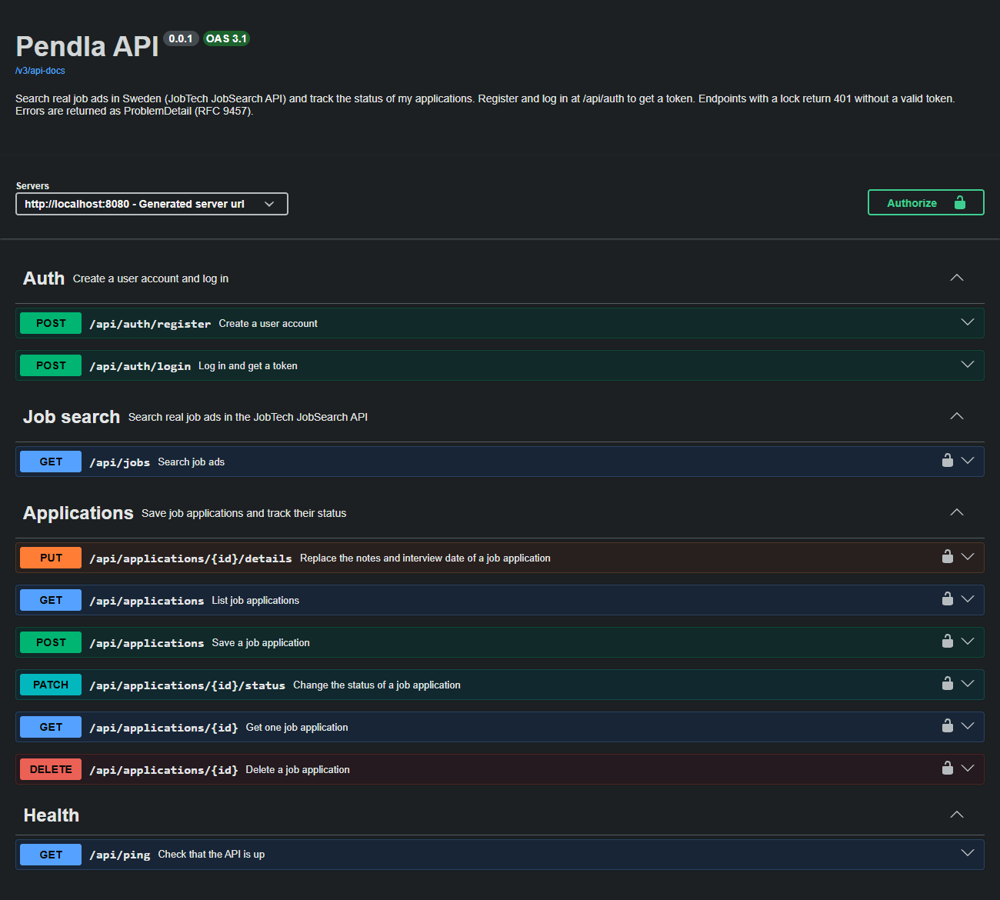
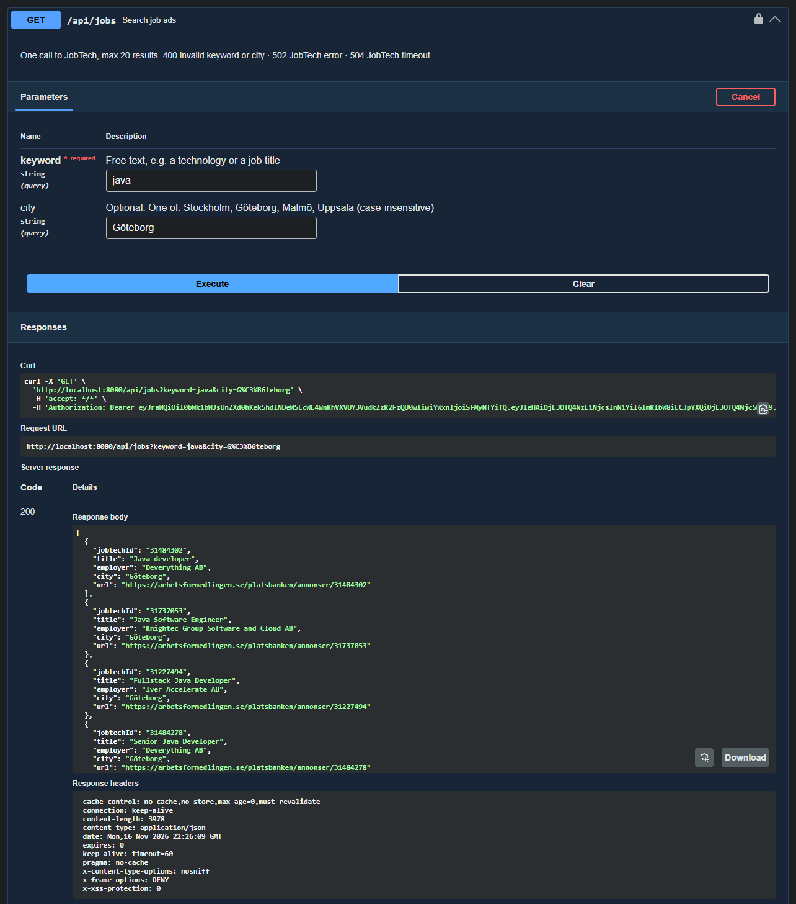
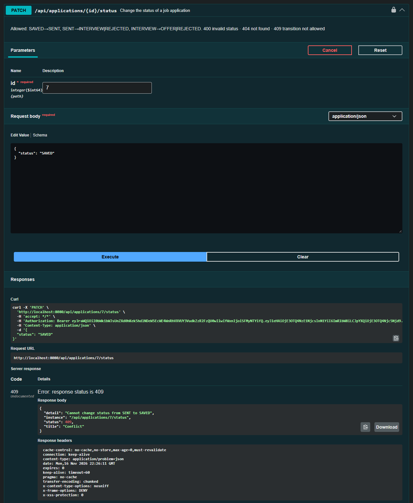

# Pendla

[](https://github.com/anevadog/pendla/actions/workflows/ci.yml)

A small REST API to track my job search in Sweden.

Pendla does three things:

1. **Search real job ads** from the public JobTech API (Arbetsförmedlingen) by keyword and city, and return a simplified version of each ad (title, employer, city, link).
2. **Track my applications**: save the ads I am interested in, follow their status (`SAVED → SENT → INTERVIEW → REJECTED / OFFER`) and keep notes and the interview date on each one.
3. **Protect the API**: users register and log in, every other endpoint needs a JWT, and each user sees only their own applications.

**Live:** [pendla.onrender.com/swagger-ui.html](https://pendla.onrender.com/swagger-ui.html). It runs on a free plan that sleeps when nobody uses it, so the first request can take about a minute. Registration is closed on the public server, so the endpoints can be browsed but not used without my account: to try it end to end, run it locally (below).

## Why I built it

I want to work in Sweden as a backend Java developer, and I use this tool in my own job search. It is also a portfolio project: small, finished, and every part of it explainable.

What it demonstrates:

- Layered architecture (controller, service, repository), organized by feature
- DTOs: JPA entities are never exposed in HTTP responses
- Business rules in the domain: status transitions live in the status enum
- Consuming an external API with timeouts and controlled errors (`502` / `504`, no retries)
- Input validation and centralized error handling (`@ControllerAdvice` + `ProblemDetail`)
- Authentication with Spring Security: BCrypt password hashes and stateless JWT tokens
- Data ownership: every application belongs to a user (`@ManyToOne`), and every query filters by its owner
- Persistence with Spring Data JPA and PostgreSQL, with a versioned schema (Flyway migrations)
- Unit and web-layer tests that need no database and no network, plus a repository test against a real PostgreSQL (Testcontainers)
- Continuous integration: GitHub Actions runs the tests on every push
- Deployment: a two-stage Dockerfile, deployed to Render with the database on Neon, configured only through environment variables
- API documentation with Swagger (OpenAPI)

## Tech stack

Java 25 · Spring Boot 4.1 · Maven · Spring Data JPA · PostgreSQL · Flyway · Bean Validation · Spring Security (JWT) · RestClient · springdoc-openapi · JUnit 5 · Mockito · MockMvc · MockRestServiceServer · Testcontainers · Docker · Docker Compose · Render · Neon

## Screenshots

All endpoints in Swagger UI:



A real search in JobTech for Java jobs in Göteborg:



A status change that is not allowed (`SENT → SAVED`) returns `409` as `ProblemDetail`:



## Status

Finished and deployed: every feature below works end to end against PostgreSQL and the real JobTech API, the tests run on every push, and Render deploys every push to `master`. Technical decisions and the alternatives I discarded: [docs/decisiones.md](docs/decisiones.md) (Spanish).

Planned next, one small step at a time:

- Pagination for the job search and the applications list
- More cities, using the JobTech taxonomy API

## How to run

Prerequisites: Java 25, and either Docker or PostgreSQL installed locally.

1. Copy `.env.example` to `.env`, choose a database password and set `JWT_SECRET` to a random string of at least 32 characters (it signs the login tokens). The app reads `.env` on startup.
2. Get a database, in one of two ways:

   **With Docker Compose.** Set the port in `DB_URL` to `5433` in `.env`, then start PostgreSQL 18 (Compose reads the user and the password from the same `.env`):

   ```bash
   docker compose up -d
   ```

   `docker compose down` stops it and keeps the data.

   **With PostgreSQL installed locally.** Create the user and the database (as the `postgres` superuser), with the password from `.env`:

   ```sql
   CREATE USER pendla WITH PASSWORD 'your-password';
   CREATE DATABASE pendla OWNER pendla;
   ```

3. Start the application (on Windows PowerShell use `.\mvnw.cmd` instead of `./mvnw`):

   ```bash
   ./mvnw spring-boot:run
   ```

   On startup, Flyway creates the tables from the SQL migrations in `src/main/resources/db/migration`.

4. Check it is up: `http://localhost:8080/api/ping` returns `pong`.
5. Open Swagger UI at `http://localhost:8080/swagger-ui.html`. Every endpoint has example values ready for "Try it out". Register and log in under **Auth**, then paste the token in the **Authorize** button to use the other endpoints.

### Run it as a container

The `Dockerfile` builds the application in one stage and runs it on a plain Java runtime in another. This is how the public server runs it. With the Compose database up:

```bash
docker build -t pendla .
docker run --rm --env-file .env -e DB_URL=jdbc:postgresql://postgres:5432/pendla --network pendla_default -p 8080:8080 pendla
```

Inside the Compose network the database is `postgres:5432`, not `localhost:5433`.

### Configuration

Everything is read from environment variables (or `.env` when running locally):

| Variable | Required | Meaning |
|---|---|---|
| `DB_URL` | yes | JDBC URL, for example `jdbc:postgresql://localhost:5433/pendla`. A hosted database may need `?sslmode=require` |
| `DB_USERNAME`, `DB_PASSWORD` | yes | Database user and password |
| `JWT_SECRET` | yes | Signs the login tokens. At least 32 characters |
| `REGISTRATION_ENABLED` | no | `true` by default. `false` closes registration (`403`); the public server uses it |
| `PORT` | no | HTTP port, `8080` by default. Hosting platforms set it |

## Typical flow

The examples use `curl` in a bash shell (Git Bash on Windows). Responses are shortened.

**1. Create an account and log in:**

```bash
curl -X POST http://localhost:8080/api/auth/register \
  -H "Content-Type: application/json" \
  -d '{"username": "alex", "password": "correct-horse-battery"}'
```

```bash
curl -X POST http://localhost:8080/api/auth/login \
  -H "Content-Type: application/json" \
  -d '{"username": "alex", "password": "correct-horse-battery"}'
```

```json
{
  "token": "eyJhbGciOiJIUzI1NiJ9...",
  "expiresAt": "2026-11-16T12:15:53Z"
}
```

Every other request needs that token in the `Authorization` header. The examples below read it from a shell variable:

```bash
TOKEN="eyJhbGciOiJIUzI1NiJ9..."
```

Without a token, or with one that is invalid or expired, the answer is `401`.

**2. Search job ads** (max 20 results, `city` is optional):

```bash
curl "http://localhost:8080/api/jobs?keyword=java&city=Stockholm" \
  -H "Authorization: Bearer $TOKEN"
```

```json
[
  {
    "jobtechId": "31696992",
    "title": "Integrationsutvecklare Java",
    "employer": "Deploja AB",
    "city": "Stockholm",
    "url": "https://arbetsformedlingen.se/platsbanken/annonser/31696992"
  }
]
```

**3. Save the one I am interested in** (it starts as `SAVED`):

```bash
curl -X POST http://localhost:8080/api/applications \
  -H "Authorization: Bearer $TOKEN" \
  -H "Content-Type: application/json" \
  -d '{"jobtechId": "31696992", "title": "Integrationsutvecklare Java", "employer": "Deploja AB",
       "city": "Stockholm", "url": "https://arbetsformedlingen.se/platsbanken/annonser/31696992"}'
```

```json
{
  "id": 1,
  "jobtechId": "31696992",
  "title": "Integrationsutvecklare Java",
  "employer": "Deploja AB",
  "city": "Stockholm",
  "url": "https://arbetsformedlingen.se/platsbanken/annonser/31696992",
  "status": "SAVED",
  "createdAt": "2026-11-09T10:00:00Z",
  "notes": null,
  "interviewAt": null
}
```

**4. Mark it as sent:**

```bash
curl -X PATCH http://localhost:8080/api/applications/1/status \
  -H "Authorization: Bearer $TOKEN" \
  -H "Content-Type: application/json" \
  -d '{"status": "SENT"}'
```

The response is the same application with `"status": "SENT"`.

**5. A transition that is not allowed** returns `409`:

```bash
curl -X PATCH http://localhost:8080/api/applications/1/status \
  -H "Authorization: Bearer $TOKEN" \
  -H "Content-Type: application/json" \
  -d '{"status": "SAVED"}'
```

```json
{
  "title": "Conflict",
  "status": 409,
  "detail": "Cannot change status from SENT to SAVED",
  "instance": "/api/applications/1/status"
}
```

**6. Add notes and the interview date:**

```bash
curl -X PUT http://localhost:8080/api/applications/1/details \
  -H "Authorization: Bearer $TOKEN" \
  -H "Content-Type: application/json" \
  -d '{"notes": "Technical interview with the backend team. Prepare Spring and SQL questions.",
       "interviewAt": "2026-11-20T10:00:00+01:00"}'
```

The response is the same application with the two fields. The date is always returned in UTC:

```json
{
  "notes": "Technical interview with the backend team. Prepare Spring and SQL questions.",
  "interviewAt": "2026-11-20T09:00:00Z"
}
```

`PUT` replaces both fields: a field that is `null` or missing is cleared, so `{}` removes the notes and the date. Notes are free text for my own use and must not include third-party contact data (recruiter names, emails or phone numbers).

## Endpoints

| Method | Path | Description | Errors |
|---|---|---|---|
| GET | `/api/ping` | Health check, returns `pong` | — |
| POST | `/api/auth/register` | Create a user account (`201`). The username is stored in lowercase | `400` invalid data · `403` registration is closed on this server · `409` username already taken |
| POST | `/api/auth/login` | Log in and get a JWT, valid for one hour | `400` invalid data · `401` wrong username or password |
| GET | `/api/jobs?keyword=java&city=Göteborg` | Search job ads in JobTech, max 20. `city` is optional: Stockholm, Göteborg, Malmö or Uppsala (case-insensitive) | `400` invalid keyword or city · `502` JobTech error · `504` JobTech timeout |
| POST | `/api/applications` | Save a job application (`201`, status `SAVED`) | `400` invalid data · `409` you already saved this JobTech ad |
| GET | `/api/applications` | List your applications, newest first. Optional filter: `?status=SENT` | `400` invalid status |
| GET | `/api/applications/{id}` | Get one application | `404` not found |
| PATCH | `/api/applications/{id}/status` | Change the status of an application | `400` invalid status · `404` not found · `409` transition not allowed |
| PUT | `/api/applications/{id}/details` | Replace the notes and the interview date (`null` or missing clears the field). Works in any status | `400` notes over 2000 characters or invalid date · `404` not found |
| DELETE | `/api/applications/{id}` | Delete an application (`204`) | `404` not found |

`/api/ping`, `/api/auth/**` and Swagger are public. Every other endpoint also returns `401` when the request has no token, or the token is invalid or expired.

Applications belong to the user who saved them. An application of another user returns the same `404` as one that does not exist, so nobody can find out which ids are in use. Two users can save the same JobTech ad.

### Status transitions

| From | Allowed to |
|---|---|
| `SAVED` | `SENT` |
| `SENT` | `INTERVIEW`, `REJECTED` |
| `INTERVIEW` | `OFFER`, `REJECTED` |
| `REJECTED`, `OFFER` | — (final) |

An invalid transition returns `409 Conflict`. Setting the status an application already has also counts as an invalid transition.

### Errors

All errors are returned as [`ProblemDetail`](https://www.rfc-editor.org/rfc/rfc9457) JSON from a single `@RestControllerAdvice`. Validation errors include one message per invalid field or parameter:

```json
{
  "title": "Bad Request",
  "status": 400,
  "detail": "Invalid request data",
  "instance": "/api/applications",
  "errors": { "title": "must not be blank" }
}
```

A status that does not exist (in the `PATCH` body or in the `?status=` filter) returns `400` with the valid values:

```json
{
  "title": "Bad Request",
  "status": 400,
  "detail": "Invalid value 'FOO' for 'status'. Allowed values: SAVED, SENT, INTERVIEW, REJECTED, OFFER",
  "instance": "/api/applications"
}
```

## Project structure

```
io.github.anevadog.pendla
├── application/   job applications: controller, service, repository, entity, status enum, dto/
├── jobsearch/     JobTech search: controller, service, JobTech client and its config, supported cities, dto/
├── user/          accounts: register and login controller, service, token service, entity, dto/
└── common/        global error handling (ProblemDetail), security rules and Swagger config
```

The code is organized by feature: everything about one feature is in one package, and the layer is in each class name.

## Tests

```bash
./mvnw test
```

Most tests need no database and no network:

- **Domain:** status transitions (all 25 combinations) and the entity's `changeStatus` and `updateDetails`, with plain JUnit.
- **Services:** business rules with Mockito mocks (duplicates, not found, another user's application, transitions, city validation, mapping).
- **Controllers:** `@WebMvcTest` + MockMvc for status codes, validation and `ProblemDetail` responses.
- **Security:** the real filter chain with real tokens: no token, expired, signed with another key and not a token at all return `401`.
- **JobTech client:** `MockRestServiceServer` simulates JobTech: success, server error, unreadable body, no connection and timeout.

One test class uses a real database:

- **Repository:** `@DataJpaTest` against PostgreSQL 18 in a container started by Testcontainers. It runs the Flyway migrations, lets Hibernate validate the schema, and checks the unique constraint per user and that every query returns only the owner's applications. It needs Docker running and is skipped when Docker is not available; it always runs in CI.

## Known limitations

- Only four cities are supported (Stockholm, Göteborg, Malmö, Uppsala), mapped to their JobTech municipality ids.
- Some ads have several workplaces, so a search by city can include an ad whose main address is in another city.
- A token cannot be revoked: it stays valid until it expires (one hour). There are no refresh tokens.
- The public server runs on a free plan: it sleeps after 15 minutes without requests and needs about a minute to wake up.
- Validation messages follow the language of the JVM.
- An invalid interview date returns a generic `400` (`Failed to read request`) that does not name the field.
- Notes are not scanned for contact data: keeping them free of it is up to the user.

## Data source

Job ads come from the [JobTech JobSearch API](https://jobsearch.api.jobtechdev.se/) by Arbetsförmedlingen. Pendla only stores the fields it needs (title, employer, city, link) and never stores contact persons' names, emails or phone numbers.

## License

[MIT](LICENSE)
